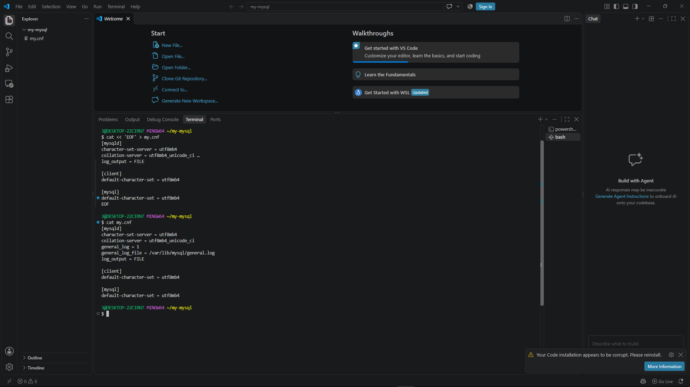
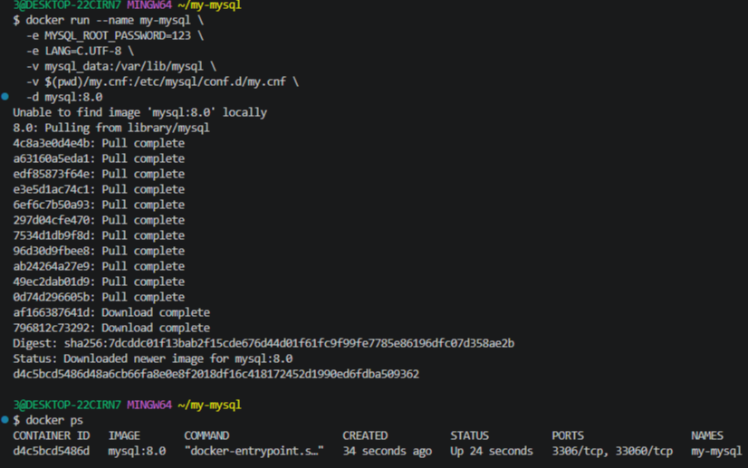
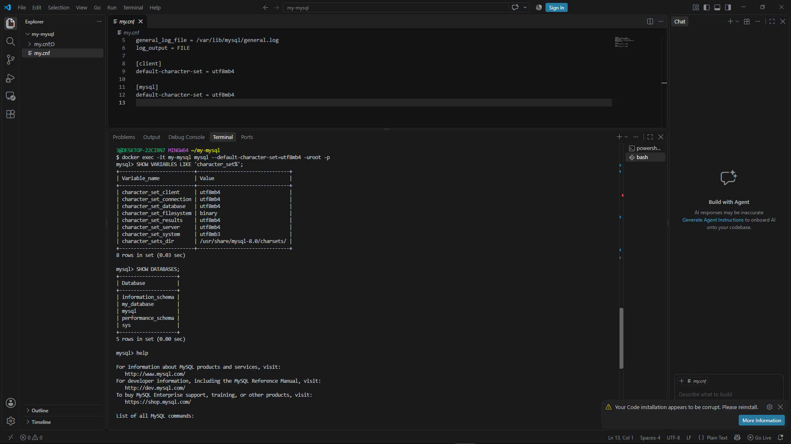
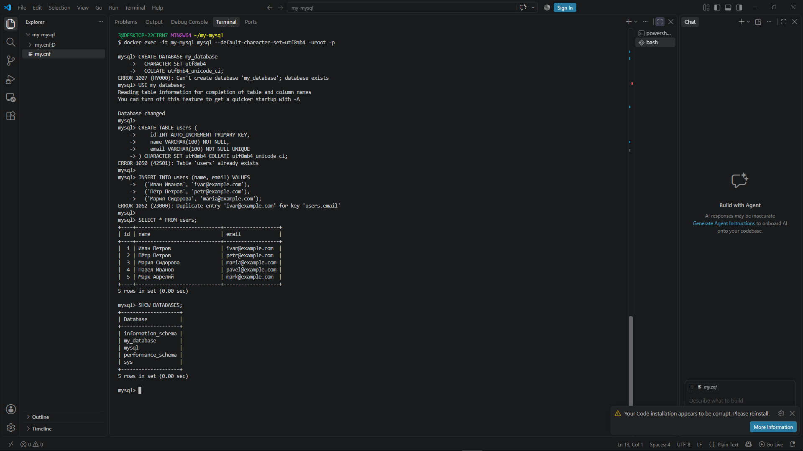
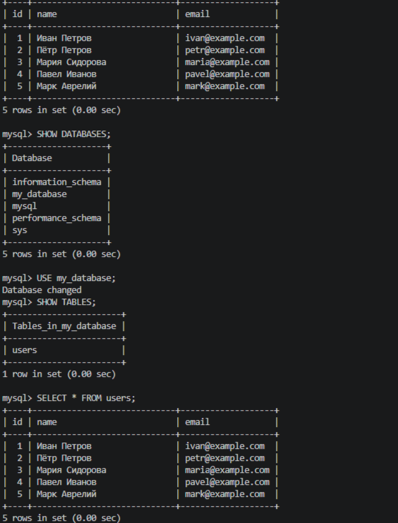
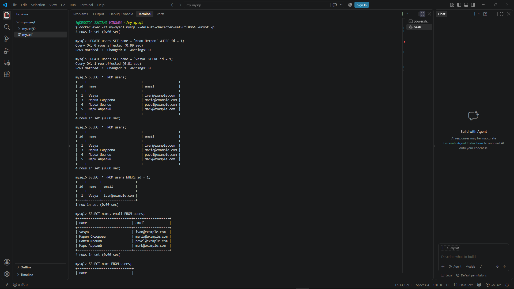
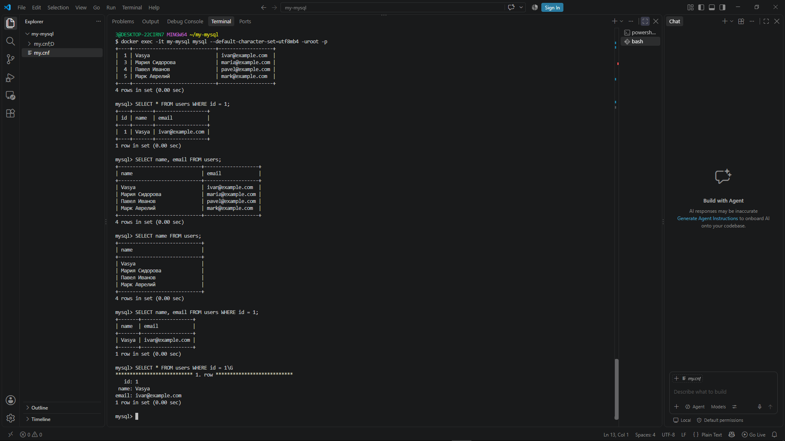
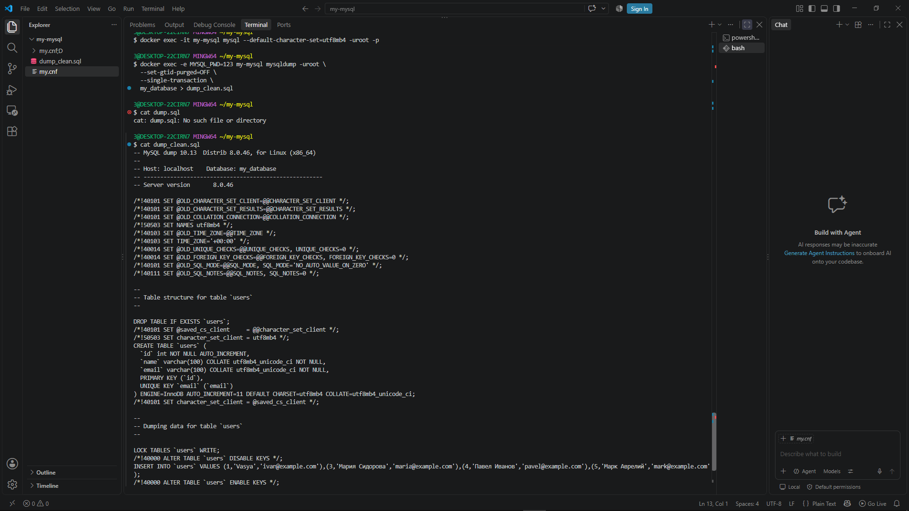
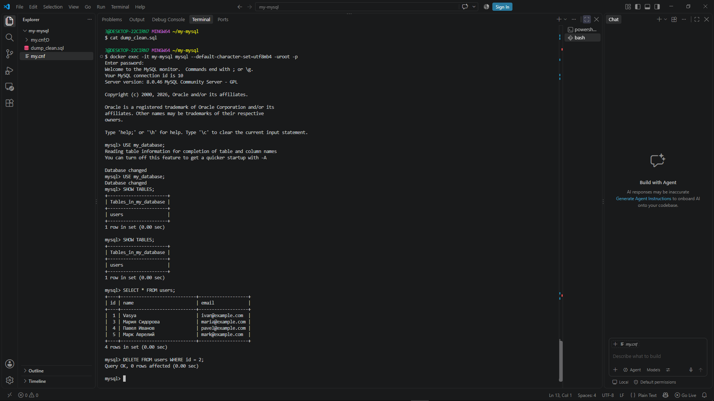
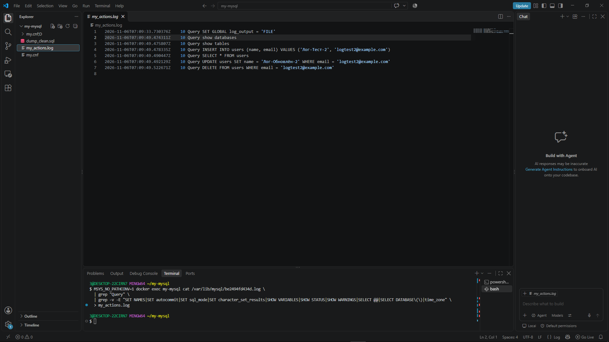

# Лабораторная работа №1: Интерактивная работа с MySQL в изолированном окружении Docker

**Выполнил:** Котохин Артем Ильич  
**Специальность:** 09.02.07 «Информационные системы и программирование»  
**Дата выполнения:** 06.11.2026  
**Тема:** Работа с СУБД MySQL (движок InnoDB) в контейнере Docker.

---

## 🎯 Цель работы
- Запуск «чистого» контейнера MySQL 8.0.
- Подключение к СУБД в интерактивном режиме.
- Выполнение основных операций с базами данных и таблицами (CRUD).
- Создание дампа базы данных для резервного копирования.
- Настройка и выгрузка журнала общих запросов (general log) с фильтрацией служебных записей.

---

## 🛠️ Используемые инструменты
- Docker (изолированное окружение)
- MySQL 8.0 (LTS)
- Git Bash / Терминал VS Code
- Текстовый редактор (VS Code)

---

## 🚀 Ход выполнения работы

### Шаг 1: Подготовка и запуск контейнера
1. Создан каталог проекта `my-mysql` и файл конфигурации `my.cnf` для установки кодировки `utf8mb4` и включения общего лога.
2. Контейнер запущен с пробросом volume `mysql_data` для сохранения данных и монтированием конфигурационного файла.

**Команда запуска:**
```bash
docker run --name my-mysql \
  -e MYSQL_ROOT_PASSWORD=123 \
  -e LANG=C.UTF-8 \
  -v mysql_data:/var/lib/mysql \
  -v $(pwd)/my.cnf:/etc/mysql/conf.d/my.cnf \
  -d mysql:8.0
```


---

### Шаг 2 и 3: Работа с базой данных (SQL)
Выполнено подключение к интерактивной оболочке MySQL и проведены следующие операции:
1. Создание базы данных `my_database` и таблицы `users`.
2. Вставка тестовых записей (включая кириллицу).
3. Обновление (`UPDATE`) и удаление (`DELETE`) записей.

**Основные SQL-команды:**
```sql
CREATE DATABASE my_database CHARACTER SET utf8mb4 COLLATE utf8mb4_unicode_ci;
USE my_database;

CREATE TABLE users (
    id INT AUTO_INCREMENT PRIMARY KEY,
    name VARCHAR(100) NOT NULL,
    email VARCHAR(100) NOT NULL UNIQUE
) CHARACTER SET utf8mb4 COLLATE utf8mb4_unicode_ci;

INSERT INTO users (name, email) VALUES ('Иван Иванов', 'ivan@example.com');
UPDATE users SET name = 'Иван Петров' WHERE id = 1;
DELETE FROM users WHERE id = 2;
```


---

### Шаг 4: Резервное копирование (Дамп БД)
Создан логический дамп базы данных на хост-машину с использованием `mysqldump` (без GTID, с согласованным снимком).

**Команда:**
```bash
docker exec -e MYSQL_PWD=123 my-mysql mysqldump -uroot \
  --set-gtid-purged=OFF \
  --single-transaction \
  my_database > dump_clean.sql
```


---

### Шаг 5: Работа с журналом (General Log)
Поскольку MySQL в Docker может использовать имя файла лога, совпадающее с ID контейнера (например, `be2494fd434d.log`), была выполнена фильтрация файла для извлечения только полезных SQL-запросов (`Query`), исключая служебные команды (`SET`, `SHOW VARIABLES` и т.д.).

**Команда фильтрации и выгрузки:**
```bash
docker exec my-mysql cat /var/lib/mysql/<имя_файла_лога>.log \
  | grep "Query" \
  | grep -v -E "SET NAMES|SET autocommit|SET sql_mode|SET character_set_results|SHOW VARIABLES|SHOW STATUS|SHOW WARNINGS|SELECT @@|SELECT DATABASE\(\)|time_zone" \
  > my_actions.log
```


---

### Шаг 6: Управление жизненным циклом контейнера
Проверены команды управления состоянием контейнера:
- Остановка: `docker stop my-mysql`
- Запуск: `docker start my-mysql`
- Просмотр системного лога Docker: `docker logs my-mysql > container_log.txt`


---

## 📂 Артефакты работы
В данной директории находятся следующие файлы, подтверждающие выполнение работы:
1. `my.cnf` — файл конфигурации СУБД.
2. `dump_clean.sql` — полный дамп базы данных `my_database`.
3. `my_actions.log` — отфильтрованный журнал выполненных SQL-запросов.
4. `container_log.txt` — системный лог контейнера Docker.
5. `README.md` — данный файл отчёта.

---












